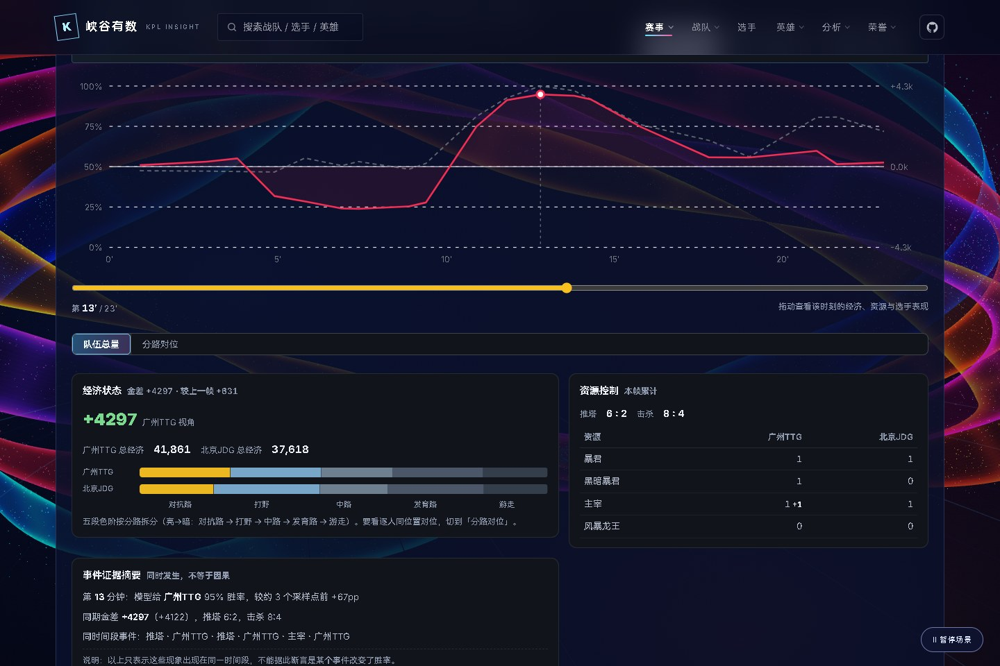

<p align="center">
  <a href="https://hccccc01333.github.io/KPLdata-site/">
    <picture>
      <source media="(max-width: 600px)" srcset="docs/images/hero-mobile.svg">
      
    </picture>
  </a>
</p>

<p align="center">
  <a href="https://github.com/hccccc01333/kpl-insight/actions/workflows/ci.yml"></a>
  <a href="pyproject.toml"></a>
  <a href="docs/licensing.md"></a>
  <a href="https://hccccc01333.github.io/KPLdata-site/"></a>
</p>

<p align="center">
  <strong><a href="https://hccccc01333.github.io/KPLdata-site/">打开网站</a></strong>
  &nbsp; · &nbsp; <a href="#可以做什么">了解功能</a>
  &nbsp; · &nbsp; <a href="docs/getting-started.md">开发文档</a>
  &nbsp; · &nbsp; <a href="https://github.com/hccccc01333/kpl-insight/issues">反馈与交流</a>
</p>

**峡谷有数**把分散的 KPL 赛事资料整理成可以查询、比较和复盘的数据工具：先查一场比赛，再了解一支队伍、一位选手或一个英雄，最后回到局内过程，观察经济、资源与局势如何变化。

面向想查数据的观众，也面向想研究数据与模型的开发者。**源码公开，限非商业使用。**

<p align="center">
  <a href="https://hccccc01333.github.io/KPLdata-site/">
    <picture>
      <source media="(max-width: 600px)" srcset="docs/images/overview-mobile.jpg">
      
    </picture>
  </a>
</p>

<p align="center"><sub>现有静态网站 · 点击图片直接体验 · 界面截图摄于 2026-10-25</sub></p>

## 可以做什么

### 01 · 从一场比赛开始

在 [赛程与比分](https://hccccc01333.github.io/KPLdata-site/schedule.html) 中找到比赛，查看系列赛与逐局结果、参赛队伍和历史交手。比赛、单局与赛事分别使用不同标识，查询口径更清楚。

### 02 · 认识战队、选手和英雄

查看 [战队](https://hccccc01333.github.io/KPLdata-site/teams.html) 的表现与风格，追踪 [选手](https://hccccc01333.github.io/KPLdata-site/players.html) 的分路与逐局数据，了解 [英雄](https://hccccc01333.github.io/KPLdata-site/heroes.html) 的使用、胜负和 Ban/Pick 情况。比较时保留赛事范围与样本量。

### 03 · 把结果放回比赛过程

在有真实时间序列的比赛中，沿时间轴查看经济、击杀、防御塔、资源与胜率变化，定位值得回看的片段。也可以通过 [BP 演播室](https://hccccc01333.github.io/KPLdata-site/bp-studio.html) 逐手查看真实选禁。

### 04 · 让数据和模型可以被讨论

本仓库公开赛程采集、快照解析、数据处理、特征构建、训练与回测工具。区分历史直播预测、当前模型重放与展示层平滑，让开发者能够检查口径、复现流程和提出改进。

### 05 · 一场系列赛的证据报告

`analyze-series` 读取一场已结束的 BO3/BO5/BO7，把四局经济、资源、BP、关键窗口和阵营变化整理成可追溯的 JSON / Markdown。它只陈述事实、统计判断与未证实假设，不把“诊断”写成教练意图或因果结论。

```bash
python -m kpl_insight series --match-id 2026102201   --site-dir /path/to/kpl-site --out report.json --md report.md
```

- [模块说明](docs/series-intelligence.md)
- [Hero 0:4 LGD 案例](docs/cases/2026102201.md)
- [10 场 Benchmark](benchmark/README.md)

> **数据覆盖** · 线上索引在 **2026-10-25** 记录了 **33 项赛事 / 2,901 场系列赛 / 11,138 局比赛**；其中 **221 局**具备分钟级复盘。历史终局与真实过程的覆盖不同，不能把总局数当作胜率评估样本。数字来自[网站数据索引](https://hccccc01333.github.io/KPLdata-site/assets/site_totals.js)。

## 界面预览

**赛程查询** · 从比赛时间与对阵找到你关心的系列赛。

[](https://hccccc01333.github.io/KPLdata-site/schedule.html)

<details>
<summary><strong>展开查看：选手数据、英雄与比赛复盘</strong></summary>

<br>

**选手数据** · 以选手为入口，连接表现、分路和具体对局。

[](https://hccccc01333.github.io/KPLdata-site/player.html?id=一诺)

**英雄与 BP** · 查看英雄使用与样本范围，再回到具体比赛。

[](https://hccccc01333.github.io/KPLdata-site/heroes.html)

**比赛复盘** · 以真实快照为基础，沿时间轴查看局势变化。

[](https://hccccc01333.github.io/KPLdata-site/match.html?id=2026062603&g=3&m=13)

</details>

## 开始使用

### 我想直接查数据

打开 **[峡谷有数静态网站](https://hccccc01333.github.io/KPLdata-site/)**，无需安装或注册。可以从 [赛程](https://hccccc01333.github.io/KPLdata-site/schedule.html)、[战队](https://hccccc01333.github.io/KPLdata-site/teams.html) 或 [选手](https://hccccc01333.github.io/KPLdata-site/players.html) 开始。

GitHub Pages 在部分国内网络仍可能不稳定。站点通过静态文件更新数据，不代表每一场历史比赛都有实时过程。

### 我想在本地打开同款网站

网站源码和已归档的静态数据在独立的 [KPLdata-site 仓库](https://github.com/hccccc01333/KPLdata-site)。安装 Git 和 Python 3 后：

```bash
git clone https://github.com/hccccc01333/KPLdata-site.git
cd KPLdata-site
python -m http.server 8000 --bind 127.0.0.1
```

在浏览器打开 **http://127.0.0.1:8000/**，即可运行自己的一份网站，无需先训练模型。保持终端运行，结束时按 `Ctrl+C`。本地展示随仓库取得的数据版本；自动采集与更新需要另外配置，部分图片等外部资源仍可能需要联网。具体说明见[本地网站指南](docs/getting-started.md#本地运行同款静态网站)。

如果这个项目对你有用，欢迎给本仓库点一颗 **Star**，让更多 KPL 同好发现它。也欢迎带着问题、需求和改进回来。

### 我想运行源码

使用 **Python 3.14**，先克隆项目并创建虚拟环境：

```bash
git clone https://github.com/hccccc01333/kpl-insight.git
cd kpl-insight
python -m venv .venv
```

激活环境：Windows PowerShell 执行 `.venv\Scripts\Activate.ps1`；macOS / Linux 执行 `source .venv/bin/activate`。然后：

```bash
python -m pip install -e .
python -m kpl_insight demo
```

离线演示使用虚构对局，在 `output/demo/` 生成快照、特征 CSV 与摘要；无需联网或模型权重。它验证软件流程，不代表真实比赛预测效果。

<details>
<summary><strong>下一步：采集真实数据、训练与本地工作台</strong></summary>

<br>

以一个联赛 ID 为例，采集赛程、回补可用快照并生成数据表：

```bash
python -m kpl_insight schedule --league-ids 20260004
python -m kpl_insight backfill --missing --limit 5
python -m kpl_insight dataset
```

首次没有模型时，可以在比赛期间仅采集真实过程：

```bash
python -m kpl_insight monitor --collect-only --league-id 20260004 --interval 3
```

请按目标赛事选择联赛 ID。历史回补通常只有终局，训练需要足够多带标签的真实快照局；详细步骤见 [上手指南](docs/getting-started.md)。

可选本地工作台读取你自己的本地数据：

```bash
python -m pip install -e ".[dashboard]"
python -m streamlit run apps/dashboard.py
```

线上网页由独立的 [KPLdata-site](https://github.com/hccccc01333/KPLdata-site) 仓库维护。本仓库提供数据与模型工具，训练数据和预训练权重不随源码发布。

</details>

## 系列赛诊断 V1

```bash
python -m kpl_insight series --match-id 2026102201 --site-dir /path/to/kpl-site
python benchmark/run_benchmark.py --site-dir /path/to/kpl-site
python -m pytest -q tests/test_series_analysis.py
```

## 开发导航

```text
kpl_insight/
├── collection/   赛程、历史归档、实时采集
├── datasets/     分析表、训练表与快照质量
├── models/       训练、预测、评估与展示层
├── site/         静态站点数据导出
├── core.py       共享解析、特征、推理与复盘
└── demo.py       离线合成数据演示
apps/            可选本地工作台
tests/           离线测试与跨天选场回归
docs/            快速上手、许可与首页图片
```

- **[上手指南](docs/getting-started.md)**：安装、采集、训练、本地工作台与数据导出。
- **[参与贡献](CONTRIBUTING.md)**：复现检查、提交范围与贡献许可。

公开文件采用白名单管理；提交前运行 `python tools/check_public_files.py`，检查是否包含不应发布的文件。

## 一起把它做得更好

欢迎带着具体比赛、问题和想法来 [Issue](https://github.com/hccccc01333/kpl-insight/issues) 交流，或提交小范围 PR：

- **数据**：补齐缺失、核对字段、改进接口变化与重复快照处理。
- **模型**：检查数据泄漏、分阶段校准、翻盘局表现与直播 / 重放差异。
- **体验**：优化查询、对比、复盘和新开发者的使用流程。

反馈时附上赛事或比赛标识、复现步骤和预期行为。贡献前请阅读 [CONTRIBUTING.md](CONTRIBUTING.md)。如果这个项目对你有帮助，欢迎 Star，也欢迎把实际使用中的问题告诉我。

## 许可

本项目采用 **[PolyForm Noncommercial 1.0.0](LICENSE)**，允许许可范围内的学习、非商业研究、修改与分享；商业用途需另行取得相应授权。含商业用途限制，因此属于源码公开项目，不属于 OSI 定义的开源软件。

赛事数据、图片、视频、队标和商标仍归各自权利人所有。完整许可范围见 [许可说明](docs/licensing.md) 和 [LICENSE](LICENSE)。

<p align="center"><sub>独立开发的 KPL 数据研究项目 · 非官方产品 · 从数据开始，也欢迎从一个 Issue 开始。</sub></p>
