<p align="center">
  <a href="https://hccccc01333.github.io/KPLdata-site/">
    <picture>
      <source media="(max-width: 600px)" srcset="docs/images/hero-mobile.svg">
      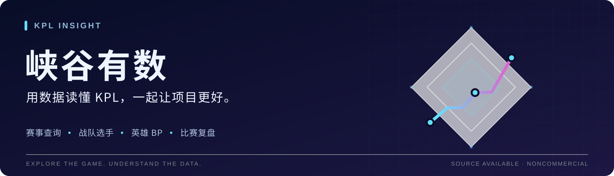
    </picture>
  </a>
</p>

<p align="center">
  <a href="https://github.com/hccccc01333/kpl-insight/actions/workflows/ci.yml"></a>
  <a href="pyproject.toml"></a>
  <a href="docs/licensing.md"></a>
  <a href="https://hccccc01333.github.io/KPLdata-site/"></a>
</p>

<p align="center">
  <strong><a href="https://hccccc01333.github.io/KPLdata-site/">打开网站</a></strong>
  &nbsp; · &nbsp; <a href="#主要功能">了解功能</a>
  &nbsp; · &nbsp; <a href="docs/getting-started.md">开发文档</a>
  &nbsp; · &nbsp; <a href="https://github.com/hccccc01333/kpl-insight/issues">反馈与交流</a>
</p>

# 峡谷有数 · KPL Insight

**峡谷有数是一个面向 KPL 观众的赛事数据分析项目。** 从查询赛程、战队和选手表现，到查看比赛中的胜率变化、模拟系列赛结果，希望让比赛数据不只停留在赛后统计，而成为理解比赛的另一种方式。

项目起于我在 **2024 年对 KPL 数据分析和比赛预测的探索**。从研究赛事页面与接口、编写采集脚本开始，逐步加入数据整理、预测模型、比赛复盘和网站展示，形成现在的峡谷有数。2024 年是早期探索阶段，并不代表现在的网站和全部功能在当时已经完成。

你可以直接打开网站，查一场比赛、比较两支队伍，或者研究一名选手在不同英雄上的表现。想了解实现过程，也可以继续阅读接口采集、特征构建、模型训练、校准与评估的说明。

欢迎直接使用峡谷有数，也欢迎借助 AI 在现有项目上扩展自己需要的功能。如果觉得新功能对其他人也有帮助，可以提交 PR，一起完善项目。

[在线体验](https://hccccc01333.github.io/KPLdata-site/) · [主要功能](#主要功能) · [接口探索](#数据接口是怎样独立探索出来的) · [技术架构](#技术架构与技术栈) · [项目沿革](#从-2024-年到现在) · [开始使用](#开始使用) · [用 AI 扩展功能](#用-ai-扩展你想要的功能)

> 文档更新：2026-10-27。本文描述当前项目实现；公开网站按版本发布，具体功能和数据以实际部署为准。网站展示的历史数据、比赛日采集程序和模型训练环境分别维护。

> **实时胜率需要本地启动。** 在线网站主要提供已归档的数据、历史预测与复盘展示，不提供打开网页即可持续运行的云端实时预测服务。要跟踪正在进行的比赛，需在自己的电脑上运行采集与预测程序，准备有效模型，并保持程序运行和网络连接。**只启动静态网页、下载体验包或打开工作台，都不等于启动实时采集与预测。**

## 这个项目想解决什么问题

看比赛时，我们通常能很快知道比分，但想进一步理解比赛，还会遇到一些具体问题：

- **比赛进行到这里，谁更有机会赢？** 经济领先、推塔、资源和战队历史表现，如何一起转成胜率估算？
- **一场比赛是怎样改变局势的？** 终局统计给出结果，时间序列才能帮助找到变化发生的时段。
- **某位选手的一场表现到底如何？** 不同位置、不同英雄承担的任务不同，需要合适的参照。
- **一支队伍怎样选择阵容？** 单场选禁、系列赛已用英雄和长期 BP 倾向，需要放在各自的样本范围内看。
- **一场 BO7 可能打成什么比分？** 单局胜率和整个系列赛的比分分布，是两个相互关联的问题。
- **分析结果能否核对？** 一句结论应当能回到具体比赛、数据范围和方法说明。

峡谷有数围绕这些问题，将采集、整理、建模和展示连接起来。你可以只使用查询功能，也可以继续深入分析与模型部分。

## 值得关注的设计

- **从一场比赛继续查下去。** 赛程、战队、选手、英雄与单局详情相互关联，汇总统计可以回到具体对局查看。
- **不只看结果，也看过程。** 在有分钟快照的比赛中，把经济、资源和胜率放在同一条时间轴上，帮助找到值得回看录像的时段。
- **用合适的参照理解表现。** 选手 × 英雄分析提供同位置、同英雄的分位数参照，减少只看总量、忽略位置职责的误读。
- **把单局和系列赛分开研究。** 局内胜率、BO7 比分模拟、逐手 BP 回放和战队长期选禁风格，分别回答不同层次的问题。
- **让分析有据可查。** 保留原始响应、数据覆盖说明与结构化报告，区分比赛事实、模型估算和仍需验证的判断。

这些设计共同构成项目的特点：不仅提供一个预测数字，也把数字背后的比赛、数据和方法连接起来。

## 界面预览

<p align="center">
  <a href="https://hccccc01333.github.io/KPLdata-site/">
    <picture>
      <source media="(max-width: 600px)" srcset="docs/images/overview-mobile.jpg">
      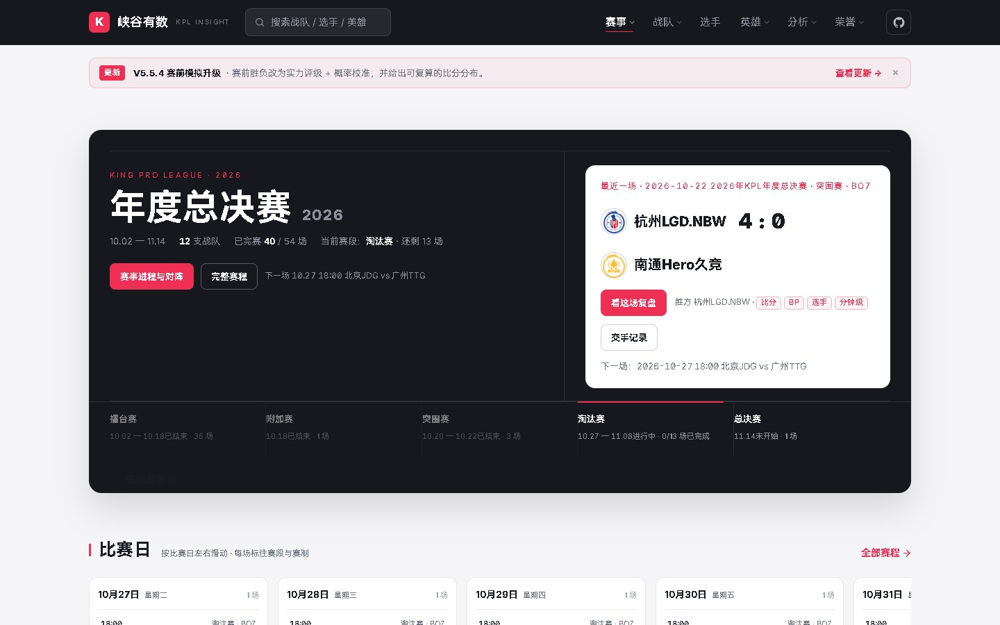
    </picture>
  </a>
</p>

首页预览默认展示；下方每个功能均可单独展开，查看操作说明、截图和数据边界。原有截图来自已部署站点；文件名带 `20261027` 的新增截图于 2026-10-27 从本地站点版本获取，可能先于线上发布，具体功能以实际部署为准。截图来源与页面路径见[图片说明](docs/images/README.md)。

## 主要功能

下面按使用场景介绍功能。普通观众可以直接使用网站；采集、训练和批量生成报告等开发工具需要在本地运行，相关步骤见“开始使用”。

### 1. 赛事查询与历史归档

**想找一场比赛，先从赛程进入。** 按赛事、赛季和日期查看对阵、比分与系列赛进程，再进入每一小局。这样既能快速知道“谁赢了”，也能继续查看“每局怎么打”。

<details>
<summary><strong>展开功能说明、操作步骤与截图</strong></summary>

- **赛程层**：查看哪一天、哪项赛事、哪两支队伍交手，以及大场结果。
- **系列赛层**：查看各局胜负、阵容与已有回放入口，区分大场比分和单局结果。
- **单局层**：查看有记录的选手、英雄、BP 与赛后统计；有过程快照时可以继续复盘。
- **历史层**：通过年份和赛事范围查询旧比赛。不同年代的数据完整度不同，具体覆盖见“数据覆盖与更新说明”。

例如，想研究两队的一次 BO7，可以先找到大场，再逐局查看阵容和胜方，而不用在不同统计页面之间重新搜索。

比赛、单局和赛事分别使用自己的标识进行关联。跨层展示时按实际战队身份对齐，处理大场对阵顺序与单局蓝红方不同的情况。

[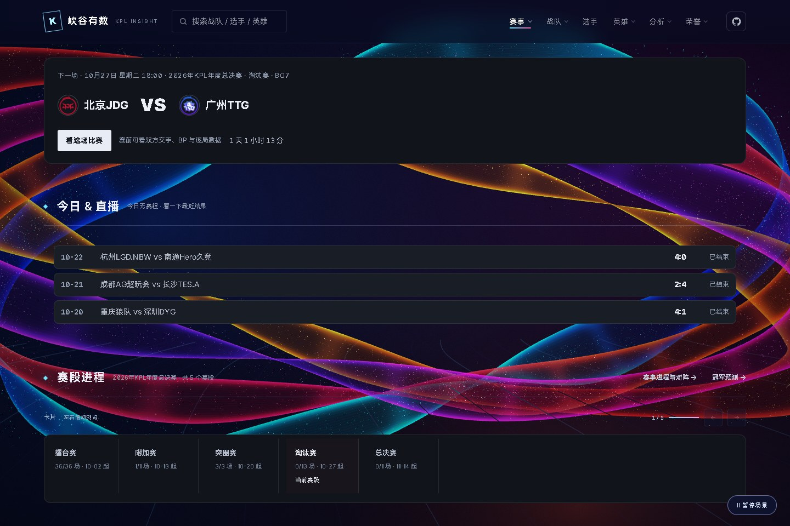](https://hccccc01333.github.io/KPLdata-site/schedule.html)

*赛程查询是比赛详情、BP 和复盘的共同入口。上图为先前留存的已部署站点截图。*

入口：[赛程与比分](https://hccccc01333.github.io/KPLdata-site/schedule.html)。

</details>

### 2. 单局胜率估算

**运行方式：本地启动采集与预测；在线网页展示已发布记录。** 实时模型不是浏览器内直接运行的公共服务，关闭本地程序后就不再持续取得新的预测。

**回答“比赛打到这一刻，哪一方更有机会获胜”。** 在取得比赛进行中的快照后，结合经济、击杀、推塔、资源、选手位置数据和历史先验，输出当前局面的获胜概率。

<details>
<summary><strong>展开功能说明、操作步骤与截图</strong></summary>

一条预测的处理过程是：

1. 读取当前快照，确认对局、时间和双方战队。
2. 计算经济差、资源差、局势变化与分路相关特征。
3. 根据比赛阶段调用模型，完成阶段混合、概率校准与输出检查。
4. 保存预测及相应时间信息，供后续复盘和核对。

当前 V12 使用早期与中后期分阶段模型、概率校准和经济一致性护栏。与只看终局胜负不同，这条链路需要持续获取过程数据；比赛日实时能力依赖采集程序实际运行。

胜率由统计学习模型计算，AI 编程助手则用于辅助代码开发。这里的 70% 表示模型对当前局面的概率估算，而不是这一场必胜。训练流程、真实样本与辅助样本的区别、概率评估方式见后文及[模型说明](docs/model-card.md)。

</details>

### 3. 分钟时间轴复盘

**把整场比赛拆成可以来回查看的时刻。** 对有分钟快照的比赛，可以切换单局、拖动时间轴，同时对照胜率、经济、击杀、防御塔、资源与选手面板，找到值得回看录像的时段。

<details>
<summary><strong>展开功能说明、操作步骤与截图</strong></summary>

建议这样使用：

1. 先看单局结果和页面给出的事实摘要，确认双方身份。
2. 展开完整时间轴，拖到自己感兴趣的分钟。
3. 对照前后经济、资源和曲线变化，定位变化窗口。
4. 结合原始录像判断具体操作与战术，不把统计变化直接当成原因。

系统分别保留**比赛当时保存的预测**和**当前模型基于历史快照重新计算的结果**。模型版本、数据完整度和采集延迟都可能使两者不同，页面及报告应按各自口径理解。

[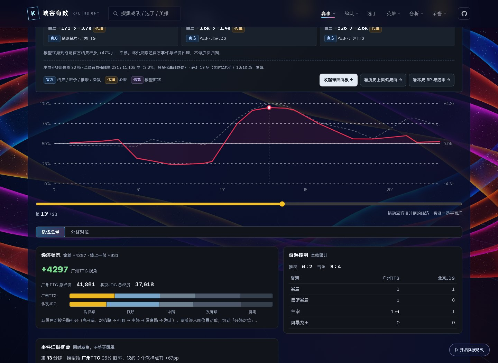](https://hccccc01333.github.io/KPLdata-site/match.html?id=2026062603&g=3&m=13)

*本地版本实拍。时间轴只适用于有过程快照的对局；查到赛果不等于拥有完整过程。模型判断与最终结果不一致时，也应保留并检查，而不是隐藏。*

</details>

### 4. 赛前大场模拟与胜率沙盘

这两个工具分别回答“开赛前可能打成什么比分”和“比赛中这种局面通常怎样发展”，不混用同一种概率。

<details>
<summary><strong>展开功能说明、操作步骤与截图</strong></summary>

#### 赛前大场模拟：从单局胜率到整场比分

选择两支队伍及 BO3、BO5、BO7 赛制，查看大场获胜概率、最可能比分、打满概率和完整比分分布。也可以手动设定单局胜率，观察同样的实力差在不同赛制下如何影响结果。

当前网站以历史 Elo 实力评级作为赛前概率基础，并按赛季滚动校准概率幅度；近期状态、历史交手等作为赛前情报展示。页面还提供走步回测、方法说明和可展开的逐局概率树。

**早期决赛预测探索使用过 BO7 蒙特卡洛模拟；当前网站按系列赛状态逐局展开，精确计算比分分布。** 两者属于不同阶段的实现，不能把早期方法名称直接当成当前网页算法。当前计算假设各局独立，不模拟临场手感延续或实际 BP 博弈。

[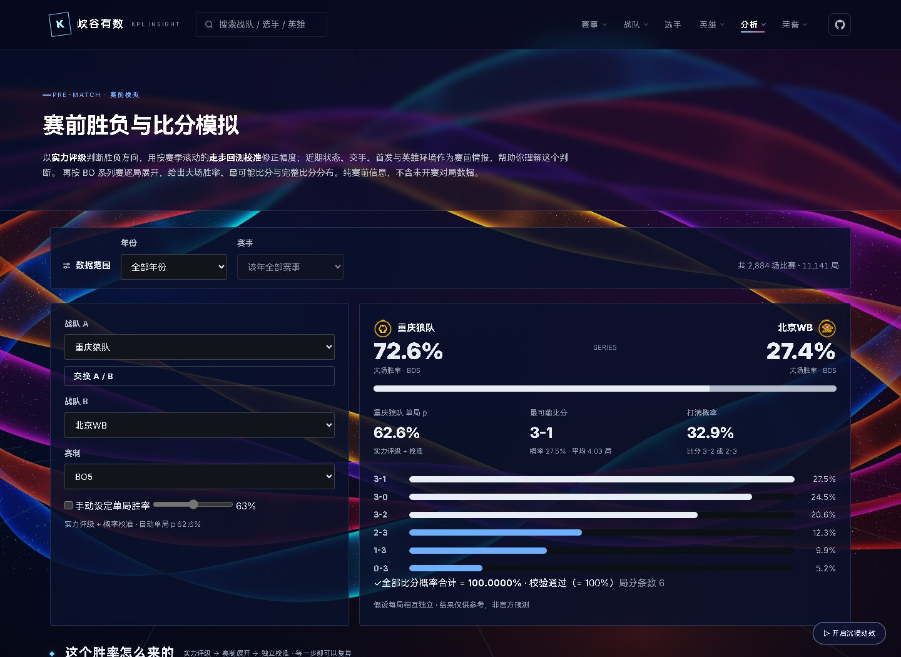](https://hccccc01333.github.io/KPLdata-site/simulator.html)

*本地版本实拍。大场胜率、单局胜率和某个具体比分的概率是不同指标，页面分别展示。*

#### 胜率沙盘：把模型判断与相似历史局面对照

选择一场比赛和某一分钟，查看当前局势、模型判断，以及相似历史对局最终的结果。页面支持切换历史结果与模型视角，并提供翻盘局、明显优势局等探索入口。

进阶功能允许调整经济差、击杀等输入，观察模型输出变化；模型体检部分则展示不同阶段的表现、校准与薄弱场景。这种条件探索用于理解模型，不意味着实战只改变一个指标就能获得同样结果。

[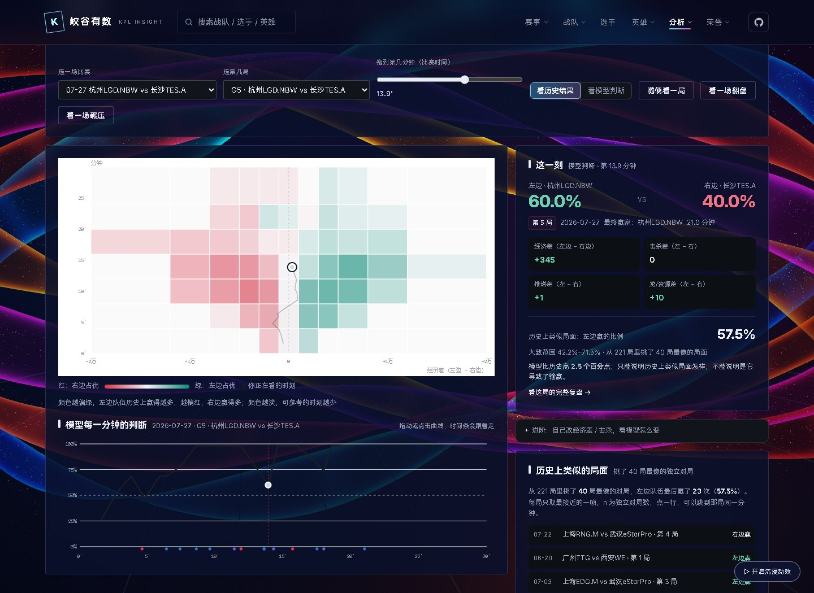](https://hccccc01333.github.io/KPLdata-site/sandbox.html)

*本地版本实拍。相似状态的历史获胜比例是样本统计，模型胜率是估算，两者可对照但不互相替代。*

入口：[大场模拟](https://hccccc01333.github.io/KPLdata-site/simulator.html) · [胜率沙盘](https://hccccc01333.github.io/KPLdata-site/sandbox.html)。

</details>

### 5. 战队、选手与英雄分析

从战队概况、选手资料和英雄环境逐步深入，最后回到同位置、同英雄的具体比赛表现。

<details>
<summary><strong>展开功能说明、操作步骤与截图</strong></summary>

#### 战队：从整体表现回到具体对局

查看战队表现、交手记录与相关比赛，再继续进入选手、英雄和 BP。适合研究同一队伍在不同赛事范围内的表现，也适合为一场对阵补充背景资料。

[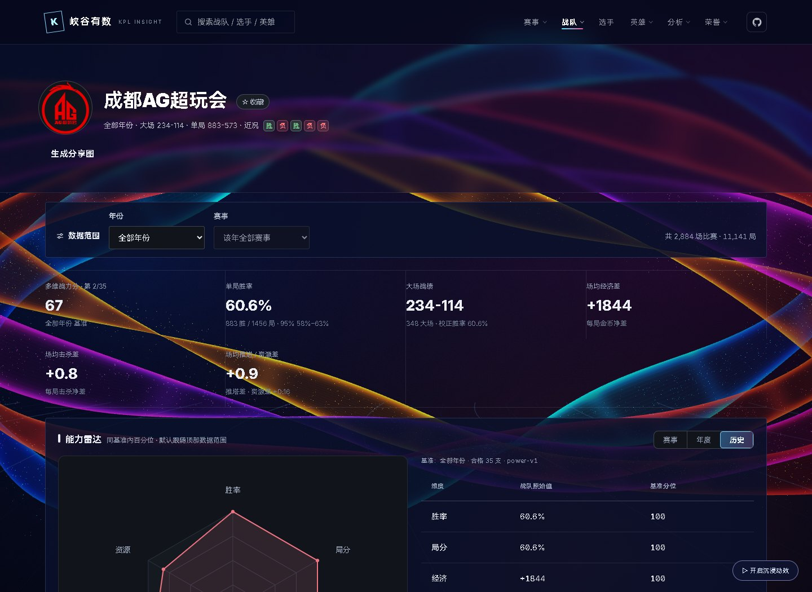](https://hccccc01333.github.io/KPLdata-site/teams.html)

*本地版本实拍。统计与所选数据范围关联，比较时需要先确认年份、赛事和样本量。*

#### 选手：不仅有排行，也能看英雄池和比赛记录

从选手资料进入位置表现、英雄使用和历史对局。选手对比页将多名选手放在同一张雷达图与指标表中；雷达默认按同位置分位归一化，表格仍保留原始统计，避免把不同职责简单换成一个总排名。

[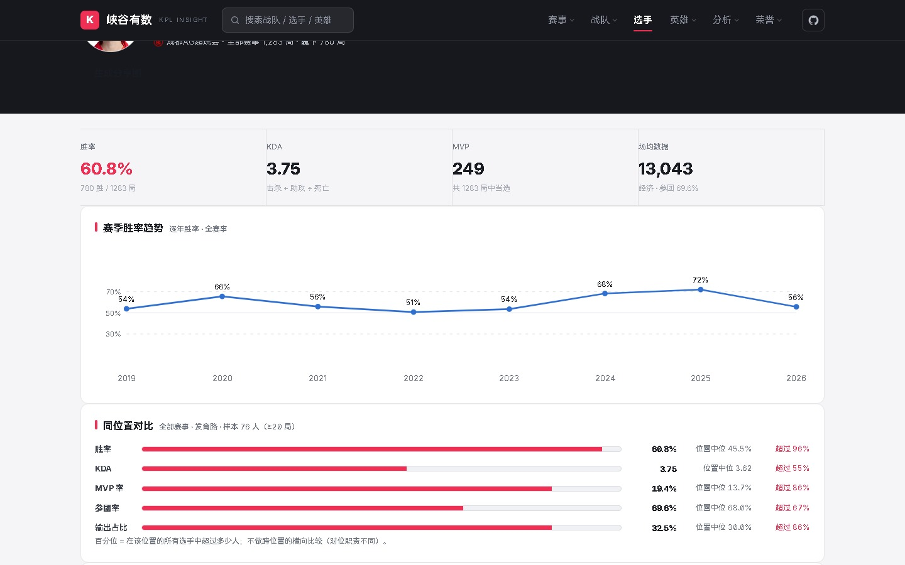](https://hccccc01333.github.io/KPLdata-site/players.html)

*先前留存的已部署站点截图。选手资料提供从名字进入比赛记录的路径。*

[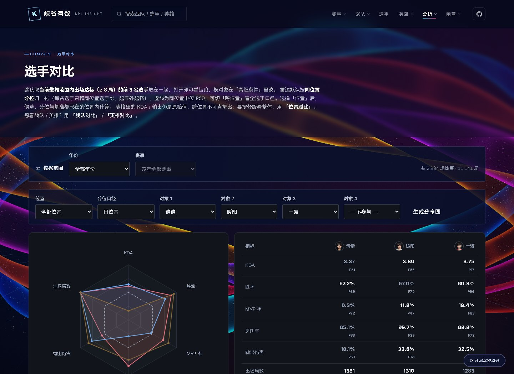](https://hccccc01333.github.io/KPLdata-site/compare-player.html)

*本地版本实拍。跨位置比较时应区分位置内分位和原始指标，输出更高不直接等于表现更好。*

#### 英雄：查看选用情况，再理解谁在使用

英雄页面提供使用、选禁和样本范围，帮助观察指定赛事中的英雄环境。英雄胜率需要连同出场量、使用战队和赛事范围一起理解，小样本高胜率不直接代表英雄强弱。

[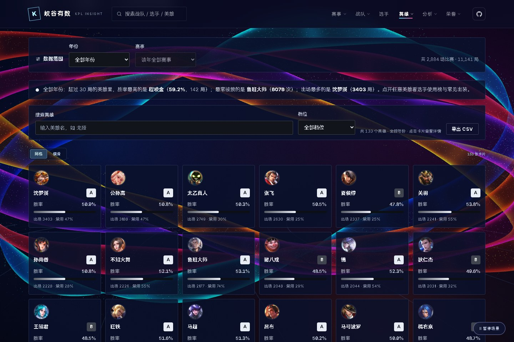](https://hccccc01333.github.io/KPLdata-site/heroes.html)

*先前留存的已部署站点截图。英雄汇总与选手个人英雄表现是不同观察角度。*

#### 选手 × 英雄：按系列赛展开，并提供同类参照

这是进一步研究个人表现的工作台：选择选手、赛事和英雄，查看出场、胜负、KDA、每分钟伤害、每分钟经济、参团率与死亡频率，再进入系列赛证据。

工作台提供**同位置、同英雄的 P50 / P75 / P90 参照**，分别表示相应样本中约第 50%、75%、90% 位置的水平。参照池不足时会扩大并标注范围，仍不足则停止评级；死亡频率等指标还需要区分“高更好”或“低更好”。

例如，想知道某位发育路选手的公孙离表现，可以先看使用样本，再看同位置同英雄的伤害与经济参照，最后回到具体系列赛，而不是只依据一次 0% 或 100% 胜率下结论。

[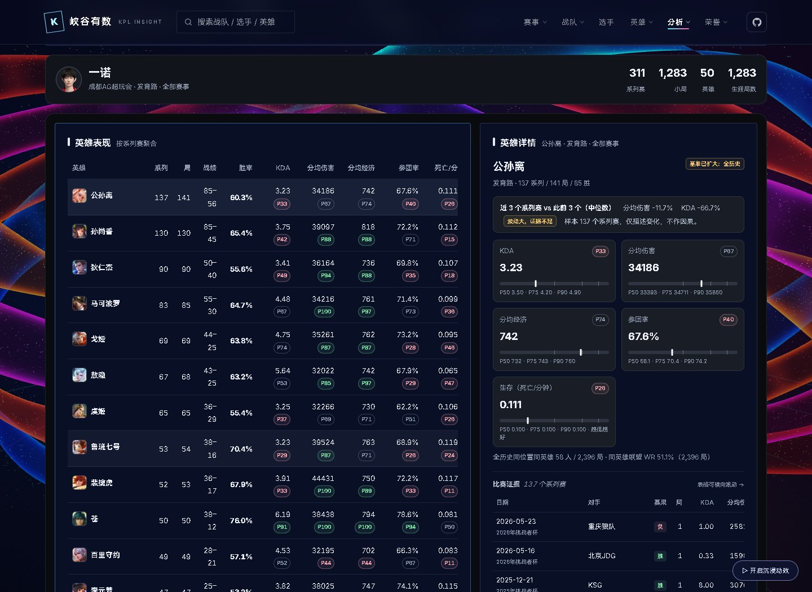](https://hccccc01333.github.io/KPLdata-site/hero-performance.html?player=一诺)

*本地版本实拍。左侧选择英雄，右侧展示指标参照、样本范围与比赛证据；分位数是描述性统计，不是官方选手评级。*

入口：[战队](https://hccccc01333.github.io/KPLdata-site/teams.html) · [选手](https://hccccc01333.github.io/KPLdata-site/players.html) · [英雄](https://hccccc01333.github.io/KPLdata-site/heroes.html) · [选手 × 英雄](https://hccccc01333.github.io/KPLdata-site/hero-performance.html)。

</details>

### 6. BP 回放、战队风格与教练档案

既能回看某一局的选禁，也能研究战队长期偏好与教练任期内的 BP 统计。

<details>
<summary><strong>展开功能说明、操作步骤与截图</strong></summary>

BP 指比赛中的英雄禁用与选择。这一部分分成“某一局怎么选”和“长期更偏好什么”两个层次。

#### BP 演播室：按顺序回看一局选禁

选择真实比赛与单局，在逐手回放和最终阵容之间切换，查看双方选禁、系列赛前几局已用英雄与本局赛后数据。已有顺序记录用于还原选禁过程，阵容卡片的展示位置不直接表示分路。

[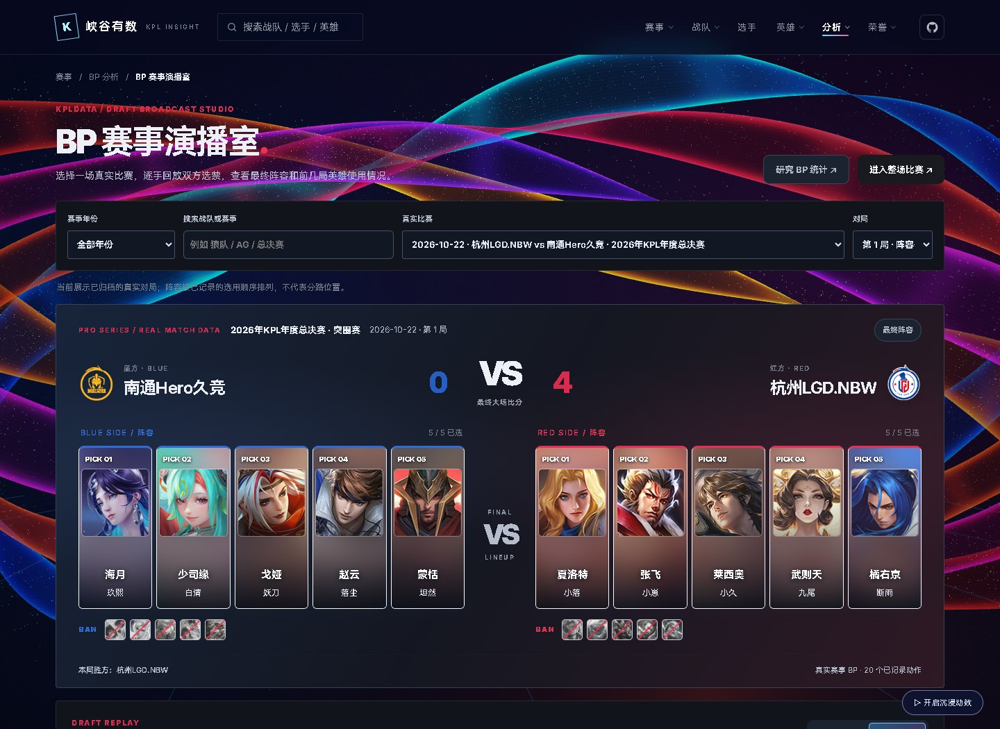](https://hccccc01333.github.io/KPLdata-site/bp-studio.html?id=2026102201&g=1)

*本地版本实拍，当前画面为最终阵容。逐手回放、前几局已用英雄和赛后统计在同页提供。*

#### 战队 BP 风格：把偏好、禁用和赛果拆开看

只使用双方各 5 选、5 禁的完整 20 手记录，展示常用英雄、选择集中度、英雄组合、己方禁用与对手禁用。

其中 **Lift 表示该队选用率与同范围联盟选用率之比**：大于 1 表示相对更偏好，不直接等于更擅长。英雄详情进一步区分己方选用、己方禁用、对手选用、对手禁用和未出现五种状态，并能回到比赛证据。

[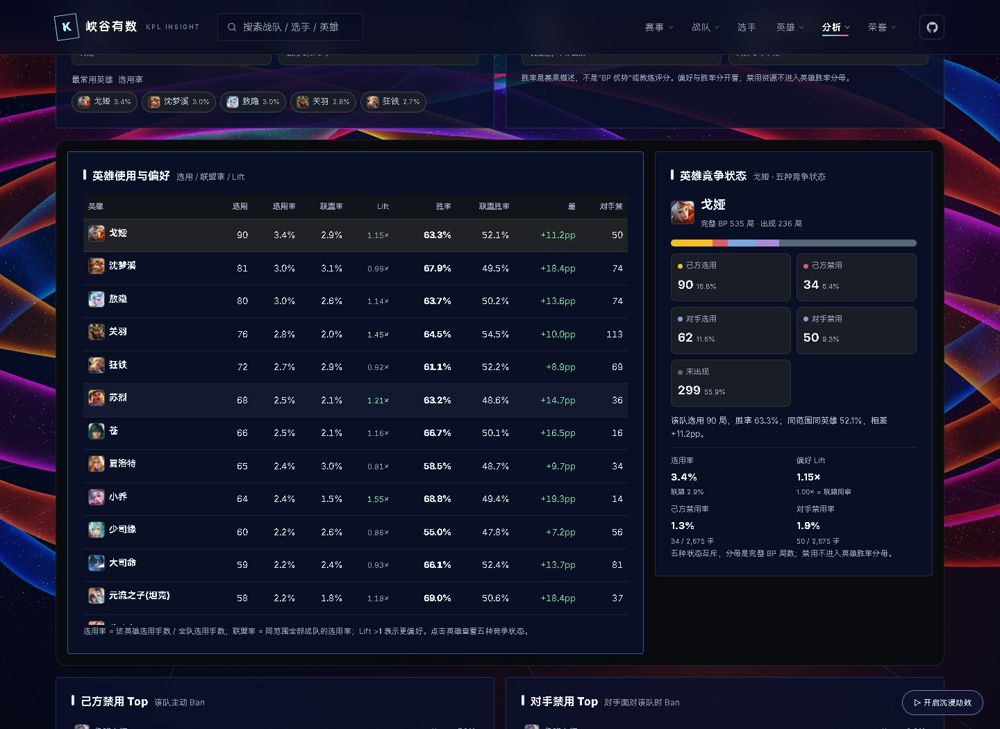](https://hccccc01333.github.io/KPLdata-site/team-bp.html)

*本地版本实拍。缺手记录不混入完整 BP 统计；当前风格工作台不分析选禁顺序，逐手回放由 BP 演播室负责。*

#### 教练档案：按任期组织资料和 BP 统计

选择教练和任期，查看对应战队的大场、小局表现，以及完整 BP 的选择与禁用结构。换队或跨赛季的任期分别记录，并展示资料来源与置信度。

当前来源包括社区整理的赛季名单，不等同于全部经过官方任免公告确认。中途换帅、角色不明确等记录保留限制，不据此直接归因。页面用于研究关联与风格，不把战队胜负全部解释为教练个人效果。

[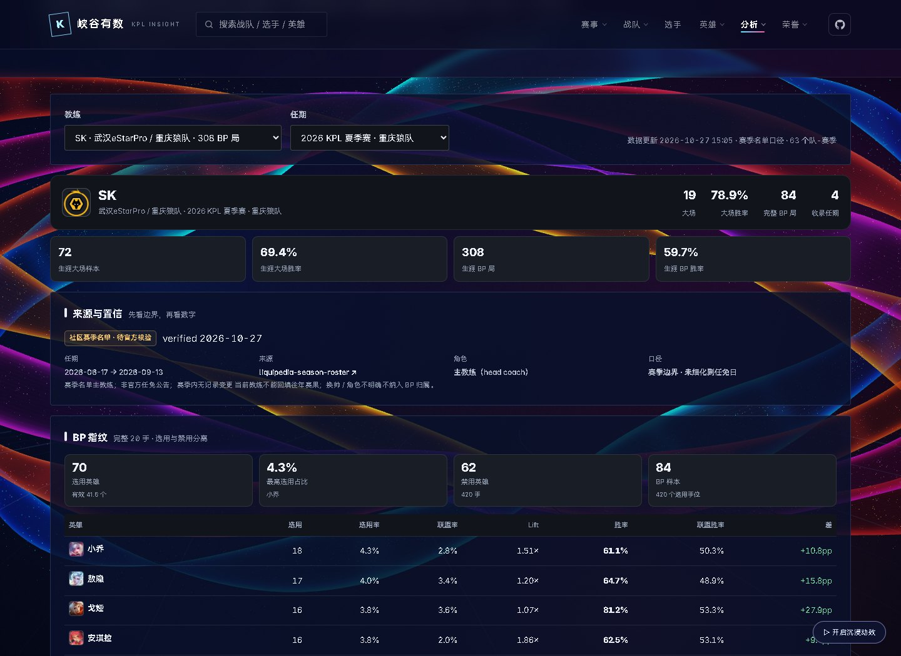](https://hccccc01333.github.io/KPLdata-site/coach.html)

*本地版本实拍。来源说明与任期边界和统计一起展示，避免脱离证据单看排名。*

入口：[BP 演播室](https://hccccc01333.github.io/KPLdata-site/bp-studio.html) · [战队 BP](https://hccccc01333.github.io/KPLdata-site/team-bp.html) · [教练档案](https://hccccc01333.github.io/KPLdata-site/coach.html)。

</details>

### 7. 系列赛证据报告

**把一场 BO3、BO5 或 BO7 整理成可核对的报告。** 输入比赛标识后，工具读取逐局数据与快照，生成结构化 JSON 和适合阅读的 Markdown；网站直接读取同一份结构化报告，减少两端重复计算带来的差异。

<details>
<summary><strong>展开功能说明、操作步骤与截图</strong></summary>

报告包括：

- **比赛概况与数据完整性**：比分、局数、哪些局有 BP 或分钟快照。
- **逐局事实**：胜方、实际阵营、时长，以及经济与资源检查点。
- **候选变化窗口**：列出值得回看录像的时段，标明模型估算或统计代理。
- **BP 与阵容**：记录已有选禁事实，不补造不存在的选禁过程。
- **结论层次**：区分可直接核对的事实、基于数据的推断和仍需验证的假设。

例如，2026-10-22 的杭州 LGD.NBW 对南通 Hero 久竞案例，将 4:0 的大场结果展开为四局检查点和变化窗口。读者可以从报告回到单局与原始记录，而不只得到一句“大比分获胜”。

[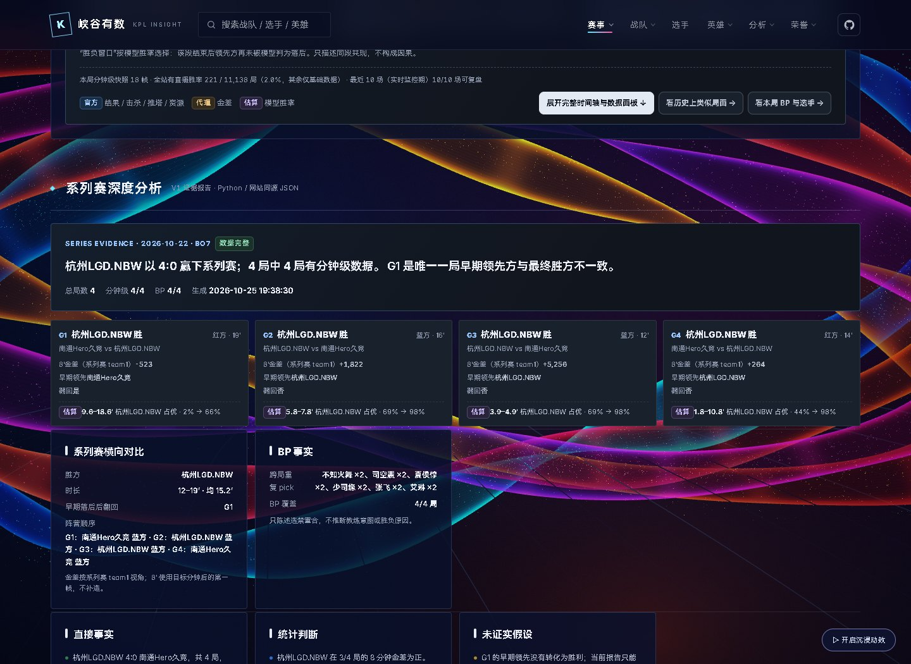](https://hccccc01333.github.io/KPLdata-site/match.html?id=2026102201)

*本地版本实拍。比分不一致、累计计数异常或缺少过程帧时，生成流程会报错、隔离或降级说明，不补造比赛过程。*

[模块说明](docs/series-intelligence.md) · [完整比赛案例](docs/cases/2026102201.md) · [固定 Benchmark](benchmark/README.md)。

</details>

### 8. 系列赛研究与辅助工具

除了单场分析，项目也提供从一组比赛出发的研究入口：

<details>
<summary><strong>展开功能说明、操作步骤与截图</strong></summary>

- **系列赛研究**：按赛制观察先赢首局后的系列赛结果、决胜局战绩与逆转记录。
- **同位置及对象对比**：对照战队、选手、英雄或分路，先统一范围与统计口径。
- **条件找局**：从具体研究条件寻找相关比赛，再进入单局核对。
- **英雄组合**：查看同队同局的英雄共现与对应结果，区分样本关联和实际配合效果。
- **荣誉与纪录**：查看已整理的赛季荣誉和赛事纪录，作为继续查找选手、战队与比赛的入口。

[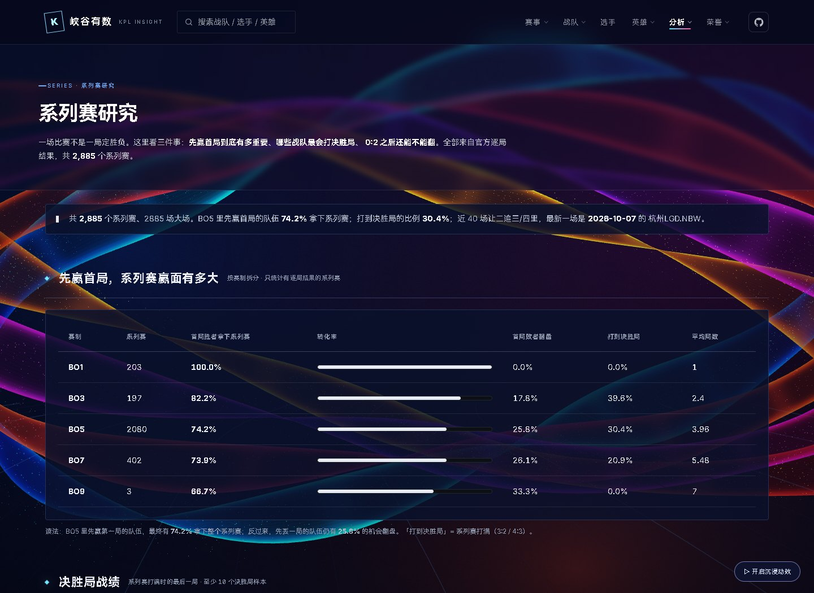](https://hccccc01333.github.io/KPLdata-site/series.html)

*本地版本实拍。这里是历史样本的汇总，不是对某一场未开赛对阵的胜率预测。*

</details>

### 9. 手机浏览与界面体验

网站使用响应式布局，兼顾电脑上的多列分析与手机上的查询浏览。3D 场景、滑动卡片和动态效果用于辅助展示，支持暂停动态效果及减少动态效果偏好；视觉效果与预测模型分别维护。

<details>
<summary><strong>展开功能说明、操作步骤与截图</strong></summary>

<p align="center">
  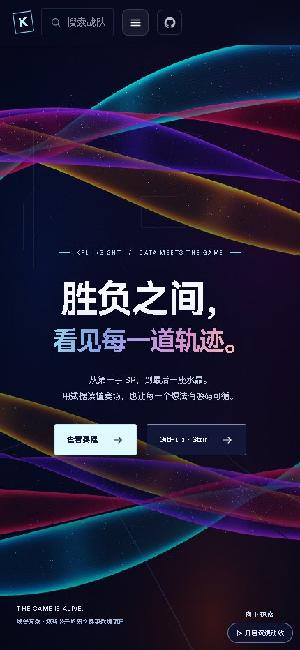
</p>

*手机宽度的本地版本实拍。复杂表格与多指标研究更适合电脑，手机可以先从搜索、赛程和单局详情开始。*

</details>

## 第一次使用，可以这样逛

### 路线一：看懂一场已经结束的比赛

打开赛程，找到大场 → 查看逐局结果 → 进入有快照的单局 → 展开复盘时间轴 → 对照经济、资源与变化窗口 → 回看原始录像。有系列赛报告的比赛，还可以先读整场概况再挑重点局。

### 路线二：研究一名选手的某个英雄

打开选手资料 → 查看英雄使用情况 → 进入选手 × 英雄工作台 → 统一赛事范围 → 对照同位置同英雄的指标与样本量 → 打开具体系列赛。先确认“比的是什么”，再讨论表现差异。

### 路线三：了解两支队伍的对阵

查看战队与交手记录 → 用赛前模拟器观察不同赛制下的比分分布 → 查看两队 BP 风格与英雄偏好。模拟结果是赛前假设下的估算，长期选禁偏好也不保证下一场采用相同阵容。

### 路线四：把自己的需求变成功能

先在现有页面找到最接近的入口 → 说清还缺什么筛选、对比或分析 → 让 AI 阅读代码并帮助修改 → 在本地核对结果 → 愿意分享时提交 PR。具体步骤和需求示例见[用 AI 扩展功能](#用-ai-扩展你想要的功能)。

## 用一场真实比赛理解项目

案例选择 **2026-06-26 北京 JDG 对广州 TTG，第 3 局**：TTG 中段经济领先，历史预测一度约 94.8%，最后却是 JDG 获胜。它适合展示查询、复盘和核对的完整过程，也保留了预测没有兑现的情况。

**赛程找到大场 → 选择 G3 → 拖动分钟时间轴 → 对照经济与资源 → 带着问题回看官方录像。**

<details>
<summary><strong>展开完整案例：先看事实，再研究变化</strong></summary>

第 767 秒的聚合数据中，TTG 经济 41,930、JDG 37,633；TTG 击杀 8:4、推塔 6:2。由此可以核对经济差 +4,297，但不能仅凭领先认定必胜。

页面留存的约 12.8′ 历史胜率为 TTG 94.8%；到约 17.8′，经济差缩小到 +1,401，历史胜率约 55.8%。这些时点帮助确定回看录像的区间，具体战术与操作仍需录像核对。

这里展示的是**历史归档记录**，不是今天重跑当前 V12 的评估结果。记录中的模型版本信息不完整，不作补猜。

[阅读完整操作路线与检查点](docs/cases/match-walkthrough.md) · [直接打开 G3](https://hccccc01333.github.io/KPLdata-site/match.html?id=2026062603&g=3&m=13)

</details>

## 交互演示

以下 GIF 来自 2026-10-27 本地版本的实际页面和正常控件操作，抽帧并加速展示，不是绘制的模拟界面。每项可单独展开；线上版本可能不同。GIF 无声音，可点击图片查看较大版本。

<details>
<summary><strong>拖动时间轴：同一局面的曲线、经济和资源一起变化</strong></summary>

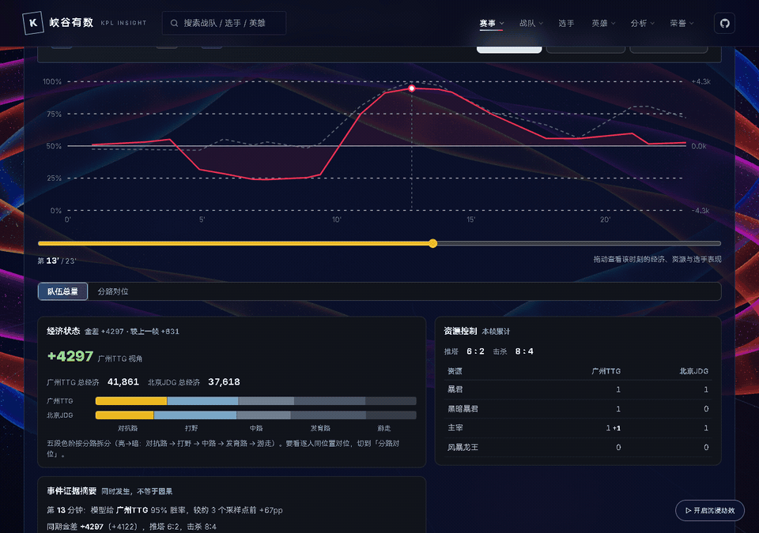

选择的是已有采样点，不表示每秒都有真实数据。[完整案例](docs/cases/match-walkthrough.md)。

</details>

<details>
<summary><strong>切换英雄：选手指标、参照和比赛证据联动</strong></summary>

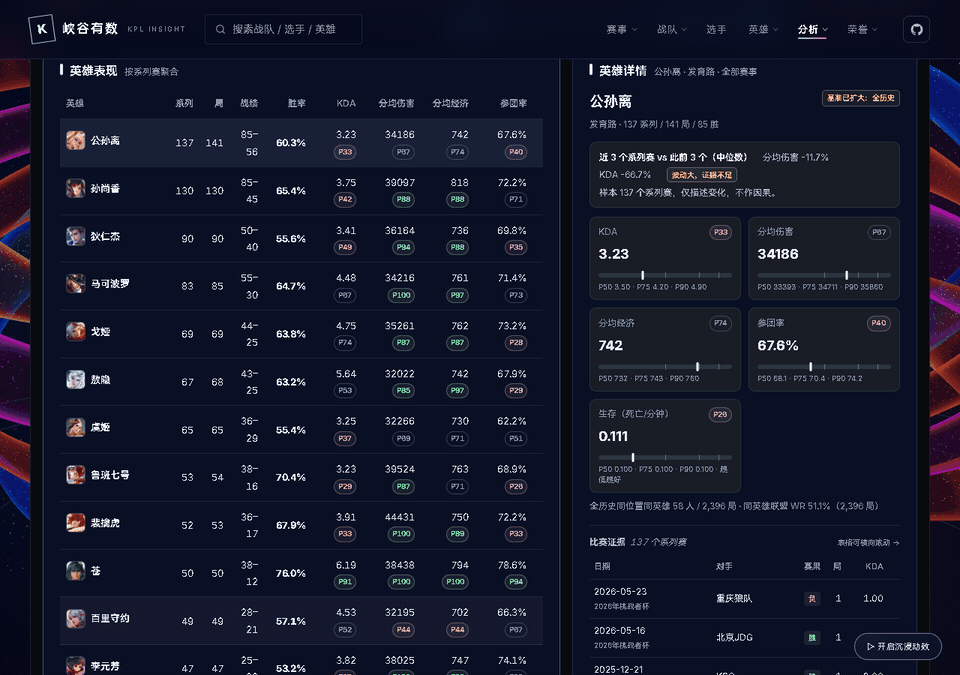

通过点击不同英雄行切换详情；参照范围和样本不足提示一并保留。

</details>

<details>
<summary><strong>逐手 BP：从开始到最终阵容</strong></summary>

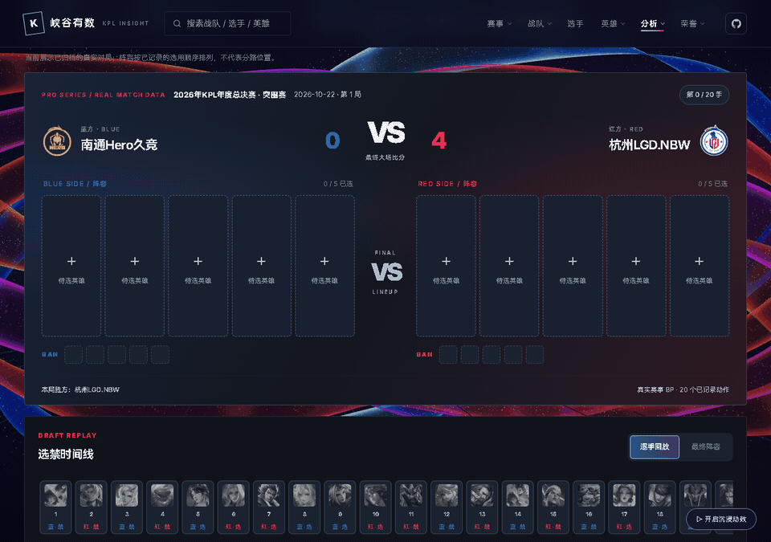

逐次点击下一手，展示已有选禁记录；不模拟未发生的 BP。

</details>

<details>
<summary><strong>调整模拟条件：单局假设与 BO 赛制如何改变比分分布</strong></summary>

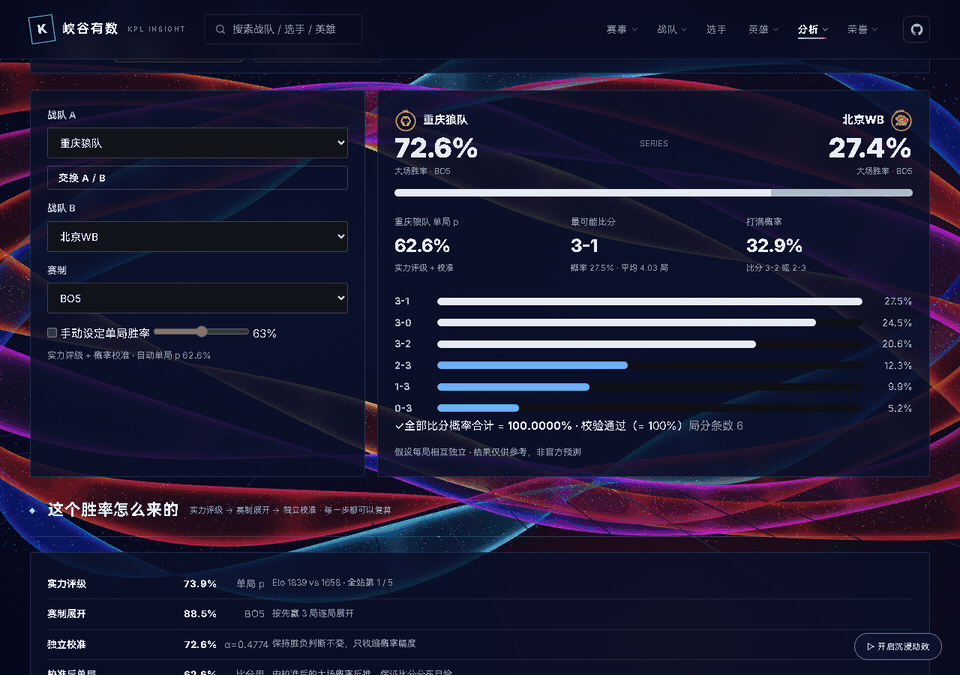

启用手动概率后调整滑块，再切换 BO3、BO7 与 BO5。此处是设定条件下的系列赛计算，不是新比赛的实时预测。

</details>

## 从原始记录到可核对的结论

### 数据怎样变成页面

公开一个最小真实聚合片段，按“接口原字段 → 秒与分钟整理 → 选定特征算术 → 历史预测对齐 → 页面取整”说明数据链路。它不包含账户、请求标识、媒体地址、完整采集目录或权重。

**4297 = 41930 − 37633**，是可直接算回去的经济差；**94.804%** 则来自已保存的历史预测，不能假装仅用这几项摘录就重新推理出了同一个概率。

[逐步查看真实字段与转换](docs/cases/data-to-page.md) · [查看最小 JSON](docs/examples/real-snapshot-excerpt.json) · [离线核对脚本](tools/verify_walkthrough.py)

### 模型怎样验证，判断错误时怎样检查

模型评估需要整局与时间隔离、独立校准、冻结后的测试，以及比赛数、时点数和版本记录。反例中 TTG 获胜标签为 0，历史概率为 0.94804，这一个时点的 Brier 为 **0.8987798416**；这只是单点误差，不是总体性能。

[验证方法、历史诊断范围与失败案例](docs/cases/model-validation-and-failure.md)说明哪些可以公开核对、哪些因未公开完整测试集和权重而无法外部复现，并将可能原因与已确认事实分开。

## 数据接口是怎样独立探索出来的

数据从哪里来，是整个项目的第一步。这里的采集主要是请求赛事页面使用的数据接口，读取结构化返回内容，再整理成后续分析能够使用的格式；历史补充集还涉及页面解析。

早期，我从官方赛事页面和浏览器里的网络请求入手，独立定位数据来源，逐项理解比赛、战队、选手和英雄字段，再编写采集脚本。随着需要回答的问题增多，单场数据获取逐步发展为比赛日监控、快照归档和分析流程。下面按这条链路说明具体做法。

### 从官方页面的网络请求找到数据来源

通过浏览器开发者工具的网络面板，查看赛事页面实际发出的请求，定位与赛程、对局有关的响应，再检查请求方法、参数、请求头和返回字段。找到候选接口后，用不同比赛的数据对照页面显示，核对比分、战队和选手等信息。

项目使用的对局接口路径之一为：

```text
https://prod.comp.smoba.qq.com/leaguesite/battle/open
```

请求单局数据时需要对应的 `battle_id`。接口地址、字段和返回行为可能变化，因此还需要在不同比赛和比赛状态下核对，确认采到的是哪一局、哪个时间点的数据。接口服务由数据提供方维护，本项目负责采集接入、字段解析和后续处理。

### 把返回数据整理成可分析的结构

返回数据包含比赛、双方战队、选手、英雄和 BP 等不同层级，不能直接当成一张扁平表使用。项目逐步整理出：

- 比赛和单局的标识、关联、状态、时长与胜负。
- 战队级经济、击杀、防御塔和大型资源。
- 选手、位置、英雄及经济、输出、承伤等字段。
- 英雄禁用与选择记录，以及可取得的回放信息。

需要进一步核对字段单位、空值、嵌套结构与不同赛事之间的差异。标识符通过接口记录和索引关联，不将未经验证的数字编码猜想作为采集依据。

### 从单场采集发展到比赛日监控

单场请求解决的是“现在能拿到什么”。实时胜率需要保存连续过程，因此采集链路还要处理：

1. 从赛程识别当前比赛及对应单局。
2. 在比赛进行时轮询接口，保存带时间信息的原始快照。
3. 将快照转成统一特征，再产生并保存预测。
4. 识别单局结束，继续跟踪后续比赛并归档结果。
5. 记录异常与缺失，避免把未取得的数据默认为零。

重试、采集间隔和状态判断都影响数据质量。接口返回历史终局时，只能得到它当前提供的状态，不能据此恢复整场真实的分钟过程。

### 保留原始记录，处理接口中的实际差异

采集后保留原始 JSON，便于重查字段、修复解析和追溯异常。后续扩展指标时，可以先检查已经保存的响应，减少重复请求。

一个具有代表性的问题是**跨局换边**：大场对阵顺序与单局阵营顺序可能不同。项目按单局实际战队身份解释胜方和胜率，再以逐局胜方汇总核对大场比分。

另一个问题是**终局摘要与过程帧不同**：系列赛分析会检查击杀、推塔、资源等累计计数是否回退，并对异常帧进行处理。相关案例和校验逻辑是数据产品的一部分。

从定位请求到形成可用数据，主要工作落在字段理解、比赛身份对齐、持续采集与异常处理上。相关实现入口列在下方“仓库与开发文档”中，历史补充数据和软件依赖的来源见“项目贡献与第三方来源”。

## 模型与分析为什么这样设计

### 比赛的不同阶段，可用信息不同

开局和后期的经济、资源与推塔含义不同。V12 采用早期随机森林专家与中后期多模型软投票，再通过分钟过渡混合与分阶段校准生成概率。

中后期候选模型包括逻辑回归、随机森林、极端随机树和梯度提升树。早期探索比较过 LR、SVM、随机森林、KNN 和 XGBoost；当前 V12 使用的是后续迭代形成的分阶段方案。

### 特征表达当前局面与已有历史

特征包括经济差及变化趋势、击杀与推塔差、资源控制、分路经济与贡献，以及只使用此前比赛构造的战队先验。

例如，同样领先一千经济，发生在第 3 分钟和第 20 分钟的含义不同；总经济相近时，经济分配和资源状态也可能不同。特征工程的作用，是把这些差异转换成模型可使用的输入。

部分“地图压力”“后期成长”等指标是根据统计字段推导的代理特征，不等于已经从视频识别出选手位置、技能或战术。

### 用概率评估约束模型

真实比赛按时间顺序、以整局为单位划分训练、校准和测试数据。同一局中相邻时点高度相关，不能随机分散到不同集合，再把高分当作泛化能力。

校准用于检查概率是否与实际结果相称。例如，许多被预测为 70% 的样本，实际获胜比例是否接近七成。Brier 等指标帮助衡量概率误差，不能只看判断胜负的准确率。

评估还要区分开局、中期、后期与翻盘局。多个快照不是多场独立比赛，相关报告需要同时说明**局数、时点数、时间范围与模型版本**。

### 真实快照与辅助样本分开解释

训练流程结合真实快照和由终局数据生成的辅助样本。辅助样本用于模型研究，不是重新发现的真实比赛过程；校准和测试需使用隔离的真实对局，并防止测试局通过辅助样本回流训练。

当前仍存在早期信息不足、翻盘局、跨版本变化和真实样本规模有限等问题。经济一致性护栏属于异常输出兜底，不能替代模型校准或独立评估。

更完整的方法、适用范围和限制见[模型说明](docs/model-card.md)。

## 数据覆盖与更新说明

**以下为已记录的数据快照，数量会随版本更新：**

- **2019–2026 主归档**：2026-10-26 记录了 33 个赛事、2,901 场系列赛、11,138 局比赛。
- **分钟级复盘**：上述归档中，221 局、65 场系列赛有对应分钟快照。能查到赛果，不代表能查看整局时间轴。
- **2016–2018 补充集**：已另外整理 584 场、1,906 局及 19,060 条选手记录；不同来源的字段完整度不一致，单独记录质量与覆盖边界。
- **训练与研究范围**：历史补充集不自动进入实时模型训练，也没有自动接入所有分析页面。例如，选手 × 英雄工作台当前使用 2019–2026 主归档。

官方比赛数据与历史补充数据分别标注来源。更早赛季的部分记录缺少完整 BP、选手经济或伤害；未知字段保持未知，不默认为没有发生。

网站读取预先构建的静态数据，打开即可浏览，无需在访问者的电脑上运行采集或训练。比赛日数据由独立的采集程序获取，经处理、导出与发布后供网站展示；页面内容以已发布的数据版本为准。

## 技术架构与技术栈

项目的数据生产、模型研究和网站访问并不是同一个进程。下面按职责拆成五张图，先看全景，再按需展开具体链路。图中展示的是模块与数据流，不表示所有步骤都已自动化。

### 1. 系统全景：数据、模型与产品如何连接

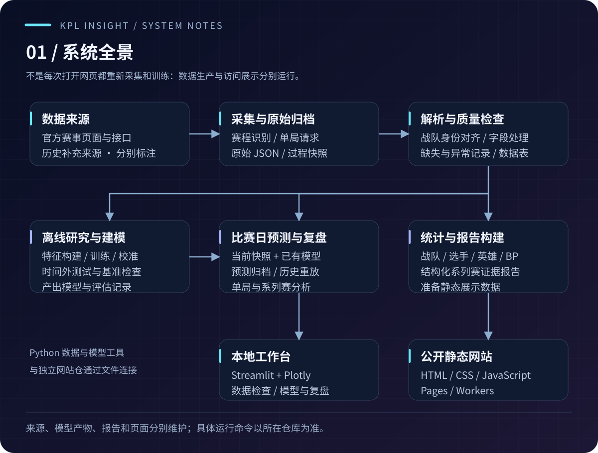

数据经过清洗后，一部分用于研究建模，一部分进入统计、报告和页面构建。比赛日预测加载已有模型；普通访问者只读取已发布的网站文件。

<details>
<summary><strong>2. 展开：比赛日采集与预测流程</strong></summary>

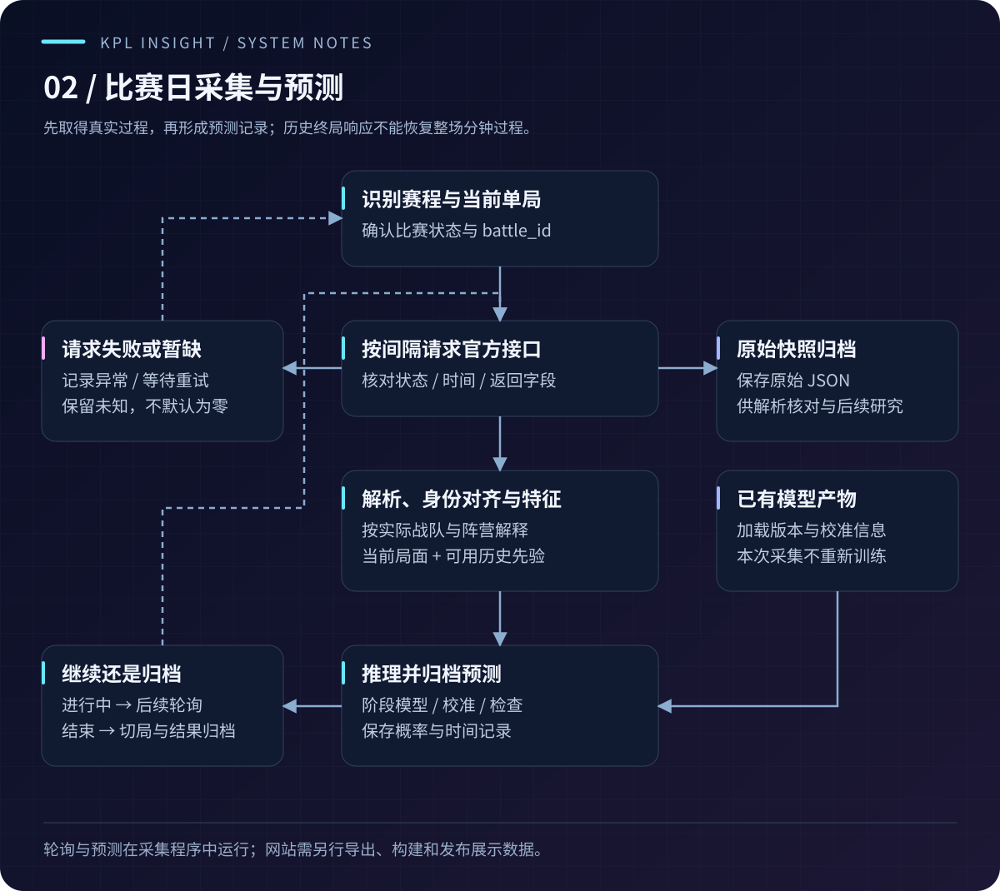

- **输入**：赛程与当前单局标识，以及接口实际返回的比赛状态。
- **核心处理**：按间隔采集，保存原始响应，统一战队身份与特征，再调用已有模型。
- **异常分支**：请求失败或暂时缺失时记录并重试，不将缺失值直接当成零。
- **输出**：原始快照、过程数据和带时间信息的预测记录；比赛结束后继续切局或归档。

这条链路解决“比赛进行时怎样留下过程”，不是从赛后一个终局响应推导出整场真实历史。

</details>

<details>
<summary><strong>3. 展开：模型训练、校准与独立评估流程</strong></summary>

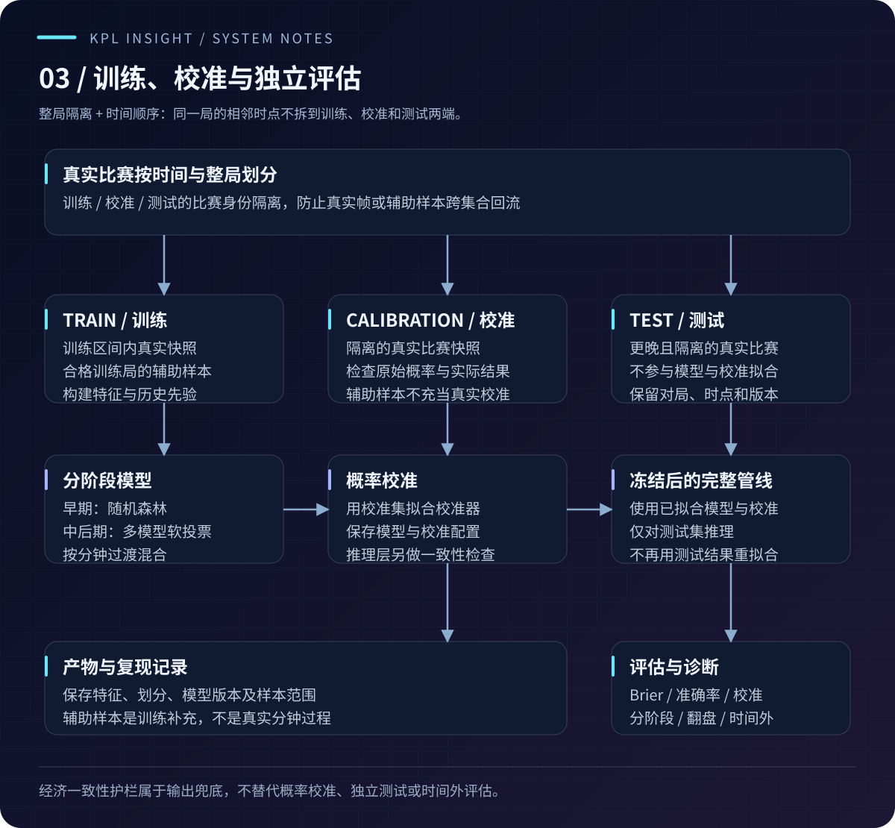

- **训练**：在允许的训练区间构建特征，结合真实快照与合格训练局的辅助样本。
- **校准**：使用隔离的真实比赛，让输出概率与实际发生频率更相称。
- **测试**：冻结模型和校准配置后，在未参与拟合的真实比赛上评估。
- **记录**：同时报告比赛数、时点数、时间范围与版本，检查早期、后期和翻盘场景。

相邻分钟帧高度相关，因此以整局划分，而不是把同一局随机拆到不同集合。辅助样本也不能绕过比赛身份隔离。

</details>

<details>
<summary><strong>4. 展开：系列赛证据报告生成流程</strong></summary>

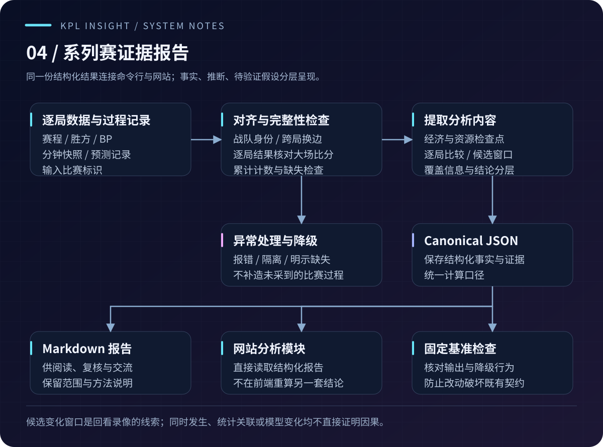

- **对齐**：先确认每局的真实战队和蓝红方，再核对大场比分。
- **检查**：识别缺帧、计数回退或输入冲突；按规则报错、隔离或降级。
- **生成**：提取检查点、候选变化窗口和分层结论，保存统一结构化报告。
- **消费**：命令行导出 Markdown，网站读取同一份 JSON；固定基准检查输出与降级行为。

报告提供证据与回看线索，不把模型变化直接解释成某个事件造成胜负。

</details>

<details>
<summary><strong>5. 展开：静态数据构建与网站发布流程</strong></summary>

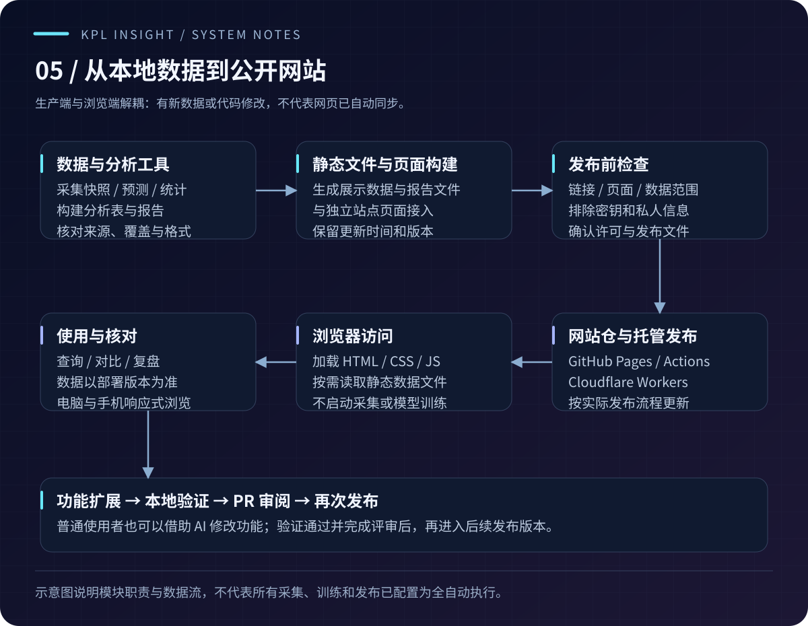

- **本地生产**：采集、模型和分析工具产生快照、预测、统计与报告。
- **构建发布**：将展示文件接入独立网站仓，检查数据范围、隐私和许可，再发布托管版本。
- **浏览访问**：加载页面与静态数据，不在访问者电脑上自动运行爬虫和训练。
- **贡献迭代**：功能修改经本地验证、PR 审阅与后续发布后，才进入公开版本。

本地新功能、模型产物、体验包和在线网站可能处于不同版本，使用时需要看对应更新时间。

</details>

### 技术栈与各自职责

- **Python、Requests**：赛事请求、批量采集与比赛日监控。
- **pandas、NumPy**：嵌套数据整理、指标聚合、特征工程和数据导出。
- **scikit-learn、SciPy、joblib**：模型训练、概率校准、评估与模型产物保存。
- **Streamlit、Plotly**：本地数据检查、分析与模型工作台。
- **HTML、CSS、原生 JavaScript**：公开网站的页面、筛选与交互；网站无需前端构建即可浏览已有静态数据。
- **Three.js**：3D 视觉场景；它负责页面体验，与预测算法分别维护。
- **GitHub Pages、GitHub Actions、Cloudflare Workers**：静态网站发布与托管。
- **Beautiful Soup**：当前历史补充集研究中使用的页面解析工具；具体工具与数据来源以相关模块为准。

项目分为数据与模型仓、静态站点仓。当前代码组织与运行方式不同，复现时应使用所在仓库对应的命令。

## 从 2024 年到现在

这个项目不是从一个完整网站开始的。2024 年，我先围绕 KPL 比赛数据做整理、分析和预测尝试；2026 年，在此前探索的基础上重新组织工程，逐步补齐采集、建模、评估和展示。下面分别记录早期探索、工程重构与公开发布的阶段。

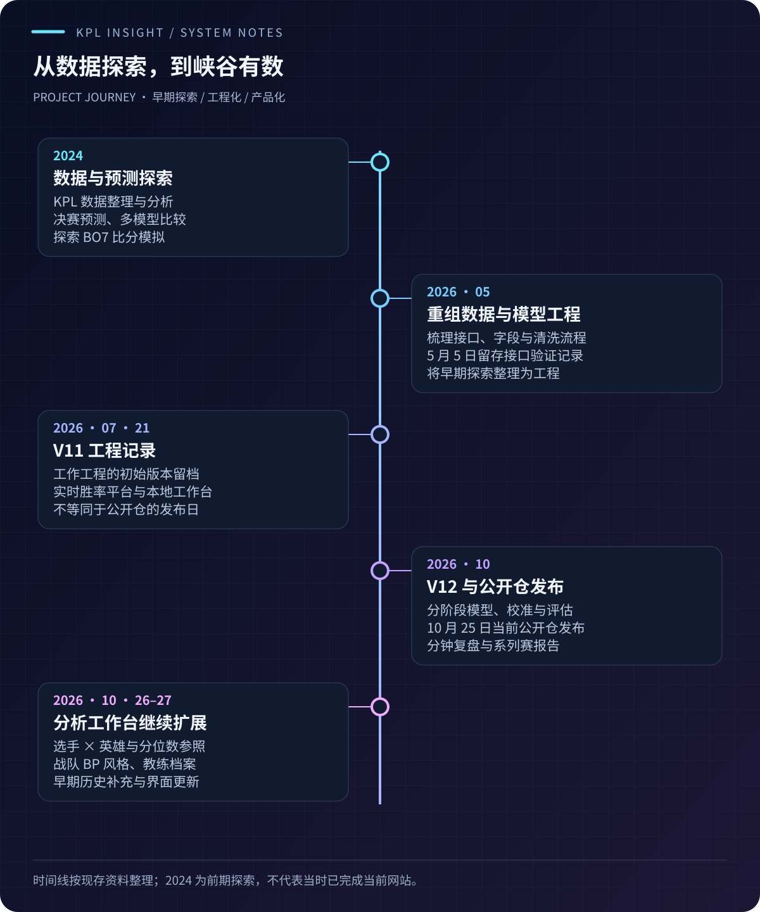

*图中分别记录早期探索、当前工程和产品扩展，不将全部现有功能追溯到 2024 年。*

<details>
<summary><strong>展开：各阶段工作与时间依据</strong></summary>

- **2024 年 · 数据分析与预测探索**：整理和分析 KPL 比赛数据，探索采集、决赛预测、多模型比较与 BO7 比分模拟。现存资料中，2024 年 5 月保存的 KPL 比赛数据和分析工程记录了早期数据工作；历史 README 与旧工程记录保留了决赛预测项目的线索。不同材料反映不同环节，不据此认定全部功能已在同一时间完成。
- **2026 年 5 月**：基于此前探索重新组织当前工程，梳理接口、字段、数据清洗与建模流程；旧接口验证脚本明确记录 5 月 5 日跑通数据请求。
- **2026 年 7 月 21 日**：当前工作工程保留 V11 实时胜率平台的初始版本记录；该时间与当前公开仓库的初始提交时间分别说明。
- **2026 年 10 月**：继续完善 V12 校准与评估、自动监控、网站查询、复盘和系列赛分析；增加时间外评估基准与静态体验包。
- **2026 年 10 月 25 日**：当前公开仓库保留初始提交，随后加入系列赛证据报告、固定基准及案例修复记录。
- **2026 年 10 月 26–27 日**：继续更新界面、选手 × 英雄工作台、战队 BP 风格、教练档案与早期历史补充集。

公开提交、版本入口及各类记录的证明范围见[项目沿革核对入口](docs/project-history.md)。早期资料暂不公开，后续需作者逐项确认与脱敏。

时间线按现存资料能够确认的阶段整理，暂不标注无法确定的最初启动日。2024 年的资料对应早期数据与预测探索；当前公开 Git 历史主要记录 2026 年以来的工程化工作，并未收录早期全部开发过程。个人文件路径、编辑器记录和私人交流材料不随公开仓库发布。

</details>

## 项目贡献与第三方来源

项目由我发起并持续开发，主要工作包括：独立探索赛事数据接口，整理字段和比赛身份，搭建采集与快照归档流程，构建特征、模型与验证方法，以及实现系列赛分析和网站展示。AI 编程助手用于辅助开发和迭代，数据含义、统计口径与结果仍需要结合实际比赛核对。

随机森林、逻辑回归等算法由相关开源库提供；项目贡献体现在赛事场景中的数据处理、特征、组合、校准、评估和产品实现。第三方软件按各自许可使用。

赛事接口及数据来自相应提供方。历史补充集包含玩加、ScoreGG 等公开赛事来源；教练任期采用注明来源和置信度的资料，不能视为全部由官方认证。

项目代码的许可见文末；第三方依赖遵循各自许可。赛事数据、图片、视频和商标的使用条件由相应权利人规定，与项目代码许可分别处理。

## 开始使用

### 普通观众：直接打开网站

访问[峡谷有数](https://hccccc01333.github.io/KPLdata-site/)，无需安装或注册。

可以从“赛程 → 某场系列赛 → 单局详情”开始；想研究选手则从“选手 → 英雄表现 → 具体比赛”进入。有时间轴数据的比赛再继续进行分钟复盘。

GitHub Pages 在部分网络环境中可能访问不稳定，可尝试 [Workers 备用地址](https://kpldata-site.hccccc01333.workers.dev)，或使用本地副本。

### 想在自己的电脑上运行网站

已安装 Git 和 Python 3 的用户，可以获取站点仓库并启动本地 HTTP 服务：

```bash
git clone https://github.com/hccccc01333/KPLdata-site.git
cd KPLdata-site
python -m http.server 8000 --bind 127.0.0.1
```

在浏览器打开 `http://127.0.0.1:8000/`，保持终端运行；结束时按 `Ctrl+C`。网页按需请求数据，请通过本地 HTTP 服务访问。

Windows 用户也可以下载[静态体验包](https://github.com/hccccc01333/kpl-insight/releases/download/static-site-20261023/kpl-insight-static-20261023.zip)，完整解压后双击“启动网站.bat”。体验包无需安装 Python 或 Node。

体验包是 **2026-10-23 的固定快照**，不包含此后全部新增功能，也不会自动更新或采集比赛。部分图片、第三方资源及原始录像仍需联网。

### 想看实时胜率：先在本地启动

以下命令在**数据与模型仓库**中运行，不是在静态网站仓库中运行。先完成下面的 Python 环境安装。

- **尚无模型**：使用 `monitor --collect-only` 仅采集真实过程，暂不输出胜率；积累合格数据后训练、校准与评估。
- **已有可信的有效模型**：启动比赛日监控，程序在本地采集快照并保存预测。公开源码不附带预训练权重，首次安装不能跳过数据准备直接获得实时胜率。

```bash
python -m kpl_insight monitor --league-id 20260004 --interval 3 --no-auto-train
```

`20260004` 是赛事 ID 示例，需按目标赛事调整。比赛未开赛、接口不可用或缺少有效模型时，不保证产生预测。运行期间保持终端和网络连接，停止时按 `Ctrl+C`。

可另开终端启动本地 Streamlit 工作台查看已有数据；**工作台不是采集程序的替代品**。若希望在线静态网站看到新结果，还需另行导出、接入站点并发布，运行监控不会自动替你部署。

[完整本地启动步骤](docs/getting-started.md#5-单局预测与实时采集) · [训练与模型限制](docs/model-card.md)

### 开发者：运行数据与模型工具

公开仓库使用 **Python 3.14**。先克隆、创建并激活虚拟环境：

```bash
git clone https://github.com/hccccc01333/kpl-insight.git
cd kpl-insight
python -m venv .venv
```

Windows PowerShell 激活命令为 `.venv\Scripts\Activate.ps1`，macOS / Linux 为 `source .venv/bin/activate`。然后安装并运行离线演示：

```bash
python -m pip install -e .
python -m kpl_insight demo
```

演示使用明确标记的合成数据，在 `output/demo/` 生成快照、特征与摘要。它用于验证软件流程，不代表真实比赛预测效果。

<details>
<summary><strong>展开：采集、训练、工作台与系列赛报告</strong></summary>

以下为操作示例，需选择目标赛事的联赛 ID。首次没有模型时，可以先仅采集：

```bash
python -m kpl_insight schedule --league-ids 20260004
python -m kpl_insight monitor --collect-only --league-id 20260004 --interval 3
```

取得足够多有标签的真实过程数据后，再生成分析表、分类快照并训练：

```bash
python -m kpl_insight dataset
python -m kpl_insight classify --dry-run
python -m kpl_insight classify --materialize
python -m kpl_insight train
python -m kpl_insight evaluate --gates
```

分类复制要求目标目录为空，已有目录会拒绝覆盖。不要为了重跑命令直接清空原始数据。历史回补通常只能取得当前可返回的状态，不能代替真实过程样本。

本地工作台：

```bash
python -m pip install -e ".[dashboard]"
python -m streamlit run apps/dashboard.py
```

系列赛报告与固定检查：

```bash
python -m kpl_insight series --match-id 2026102201 --site-dir /path/to/kpl-site --out report.json --md report.md
python benchmark/run_benchmark.py --site-dir /path/to/kpl-site
python -m unittest discover -s tests -v
```

完整环境、采集、数据格式和导出步骤见[上手指南](docs/getting-started.md)。

</details>

### 仓库与开发文档

- [数据与模型仓库](https://github.com/hccccc01333/kpl-insight)：采集、整理、特征、模型、评估与系列赛报告。
- [网站仓库](https://github.com/hccccc01333/KPLdata-site)：HTML、CSS、JavaScript 与静态展示数据。
- [架构说明](docs/architecture.md)：模块分工与数据链路。
- [数据契约](docs/data-contracts.md)：输入、输出与格式约定。
- [模型说明](docs/model-card.md)：方法、评估口径与适用边界。

想核对实现，可直接查看[赛程采集](kpl_insight/collection/schedule.py)、[比赛日监控](kpl_insight/collection/monitor.py)、[共享特征与推理](kpl_insight/core.py)、[模型训练](kpl_insight/models/train.py)、[评估](kpl_insight/models/evaluate.py)和[直播与重放检查](kpl_insight/models/replay_check.py)。

公开文件按白名单管理。准备提交代码时运行 `python tools/check_public_files.py`，检查文件范围。

## 用 AI 扩展你想要的功能

使用峡谷有数，不必只限于现有功能。如果你想增加一种筛选、一个对比视图，或者一项更符合自己看比赛习惯的分析，即使不熟悉编程，也可以尝试让 AI 编程助手在现有项目上帮助实现。

**你提出需求，AI 辅助写代码，你再用真实比赛核对结果。** 可以先在本地做一个自己用得顺手的版本；如果觉得这个功能也能帮助其他人，欢迎提交 PR（Pull Request，代码修改提案），一起完善项目。不需要先成为专业开发者，也不要求每次个人修改都提交。

### 从一个小功能开始

1. **说清楚想解决的问题。** 例如“想在选手页面同时比较两名选手使用同一英雄的表现”，明确筛选条件和希望看到的结果。
2. **让 AI 先阅读现有实现。** 页面功能从[网站仓库](https://github.com/hccccc01333/KPLdata-site)入手；采集、模型和分析逻辑从[数据与模型仓库](https://github.com/hccccc01333/kpl-insight)入手。先确认已有数据能否支持需求，再决定怎么改。
3. **在本地完成一个最小版本。** 一次只增加一个功能，尽量复用已有数据与组件，不让 AI 编造缺失字段或比赛记录。
4. **亲自检查结果。** 选择几场熟悉的比赛核对统计，检查筛选、空数据和手机显示；涉及计算逻辑时补充或运行相关测试。
5. **愿意分享时再提交 PR。** Fork 对应仓库（在自己的 GitHub 账号下创建副本），提交修改并发起 PR，说明用途、实现方法和验证结果。也可以先通过 Issue 交流想法，减少重复开发。

可以这样向 AI 描述需求：

```text
我正在使用峡谷有数，想在现有项目上增加［具体功能］，
用于解决［使用场景中的问题］，不是重新创建一个网站。

请先阅读项目 README 和相关代码，说明现有数据是否足够、
哪些文件需要修改；如果字段或统计口径不清楚，先向我确认，不要编造。

第一版只实现［最小范围］，复用已有页面风格与数据结构，
不改动无关功能，并处理空数据和手机显示。

完成后告诉我如何启动、核对结果和运行相关测试。
如果后续提交 PR，请帮我整理修改说明和验证步骤。
```

### 一个具体的贡献示例

想让手机复盘更方便，可以提出“上一采样点 / 下一采样点按钮”的需求，让 AI 阅读现有选帧逻辑，再验证首尾边界、切局、空数据、手机与键盘操作，最后整理为 PR。

[查看从需求到 PR 的完整示例](docs/contribution-example.md)。这是待实施示例，不是已开发、已提交或已合并的功能；不会因为本文出现示例就自动创建远程 PR。

### 什么样的 PR 都欢迎

新的分析功能、筛选与对比方式、数据修正、交互优化、文档和测试改进，都可以成为贡献。提交时请附上功能说明、相关比赛或数据范围、验证步骤；界面改动最好附前后截图。

AI 辅助完成的代码与其他贡献一样，需要经过核对和审阅。涉及模型、统计或采集的改动，请说明方法与数据来源；不要提交密钥、私人信息或未经允许公开的数据。PR 会结合项目方向、正确性与维护成本评审，提交并不意味着一定合并。

[功能建议与问题反馈](https://github.com/hccccc01333/kpl-insight/issues) · [贡献指南](CONTRIBUTING.md)

## 当前边界与后续工作

- **归档覆盖与过程覆盖不同。** 查到赛果不代表有分钟快照，缺失过程不会被补写成真实事件。
- **模型还需持续改进。** 早期局面、翻盘局、不同版本和有限真实样本，都会影响概率质量。
- **统计变化不等于因果。** 事件附近胜率变化不能直接证明它造成了输赢，教练与选手的意图也不能仅由统计推断。
- **视频解析仍在研究。** 第一视角的技能、轨迹与行为提取尚未完成真实验收，不作为稳定功能对外承诺。
- **发布范围有区别。** 完整采集快照和预训练权重不随公开源码分发；网页已有静态展示数据，训练复现需另行准备符合格式且有权使用的数据。

后续重点是补充真实过程样本、改进时间外评估与翻盘局分析、完善历史数据质量，并持续改善查询和复盘体验。

## 反馈与参与

欢迎使用已有网站，也欢迎提出具体问题、参与修正数据与改进代码。

反馈时附上赛事或比赛标识、页面位置、数据范围和复现步骤。例如“某场 G2 的胜方与官方大场比分对不上”，会比“数据好像不对”更容易定位。

[提交 Issue](https://github.com/hccccc01333/kpl-insight/issues) · [贡献指南](CONTRIBUTING.md) · [给项目一颗 Star](https://github.com/hccccc01333/kpl-insight)。

## 许可与声明

本发行版采用 **[PolyForm Noncommercial 1.0.0](LICENSE)**，允许许可范围内的学习、非商业研究、修改与分享；商业用途需另行取得授权。历史 MIT 部分及其许可说明保留。该许可含商业用途限制，项目属于源码公开项目，不属于 OSI 定义的开源软件。详见 [NOTICE](NOTICE) 与[许可说明](docs/licensing.md)。

本项目为个人发起的非官方项目，与腾讯及 KPL 官方无关联。赛事数据、接口服务、图片、录像、队标与商标仍归相应权利人所有，不随代码许可一并授权。模型输出用于数据分析与复盘参考。
